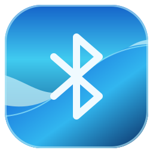

<h1 align="center">Eric-BlueToolFixup</h1>

<b>给 macOS 上的 Intel 蓝牙接通隔空投送和即时热点所需的 BLE 功能</b> 
Sonoma 14、Sequoia 15、Tahoe 26 · x86_64 · Eric-AirportItlwm 的配套项目

<a href="README.md">English</a>

---

这是 [Eric-AirportItlwm](https://github.com/Ersiter/Eric-AirportItlwm) 的蓝牙配套。从 macOS 自带的
`bluetoothd` 接通隔空发现用的 LE 广播和扫描。即时热点还要让控制器的过滤列表能处理 iPhone 的私有地址。

## 功能状态

| 功能 | 系统 | 状态 |
|---|---|---|
| LE 扩展广播与扫描 | macOS 26 Tahoe | 🧪 已核对两版的补丁字节，当前改动待上机。 |
| LE 扩展广播与扫描 | macOS 15 Sequoia、macOS 14 Sonoma | 🧪 已按 15.8 系列和 14.8.9 补齐特征码，待端到端验证。 |
| 即时热点私有地址连接 | macOS 26 Tahoe | 🧪 RPA 地址推导已离线核对，待验证热点加入和重连。 |
| `bluetoothd` 的 APFS 分页 SIGBUS 修复 | macOS 26 Tahoe | 🧪 工作源码已实现，待构建和实机验证。 |

## 安装

配套测试包将在 [Eric-AirportItlwm Releases](https://github.com/Ersiter/Eric-AirportItlwm/releases) 列出。
测试时，Wi-Fi 和蓝牙 kext 用对应系统的同一包版本。

1. 在实际启动的 EFI 里替换 `AirportItlwm.kext` 和 `BlueToolFixup.kext`。
2. 沿用 Lilu 和 Intel 蓝牙固件配置。在 `Kernel → Add` 里把唯一一条启用的 `BlueToolFixup.kext` 放在 Lilu 后面。
3. 从测试用 EFI 启动，按包内说明设启动参数。

### 启动参数

| 参数 | 作用 |
|---|---|
| `-btlfxadvsets` | 命中特征码时启用 LE 扩展广播和扫描补丁。 |
| `-btlfxrpa` | 命中特征码时启用私有地址过滤列表补丁。 |
| `-btlfxnointel` | 关掉默认的 Intel 补丁，单项参数仍能打开对应功能。 |
| `-btlfxoff` | 关闭 BlueToolFixup。 |

## 反馈问题

运行包内指定的采集脚本，写明蓝牙控制器型号、macOS 构建号、kext 版本和复现过程。隔空投送请写明发送端和
对端是否出现。蓝牙问题可以发到本仓库的 [Issue](https://github.com/Ersiter/Eric-BlueToolFixup/issues)。

## 源流

[Acidanthera/BrcmPatchRAM](https://github.com/acidanthera/BrcmPatchRAM) → Dhinak G 的 BlueToolFixup
→ 本项目，补充 Eric-AirportItlwm 在 Intel 蓝牙上所需的 BLE 功能。

## 致谢

- [Acidanthera](https://github.com/acidanthera) 与 Dhinak G：BlueToolFixup、Lilu 和 MacKernelSDK。
- [crazyhulk](https://github.com/crazyhulk) 与 [ForbiddenItlwm](https://github.com/retropineaple/ForbiddenItlwm)：BLE 补丁参考。
- [IntelBTUnified](https://github.com/laguillo/IntelBTUnified/releases/tag/v1.0.1)：压缩页 SIGBUS 的诊断和处理思路。
- [OpenIntelWireless](https://github.com/OpenIntelWireless/IntelBluetoothFirmware) 与贡献者：Intel 蓝牙固件加载和 HCI 补丁。
